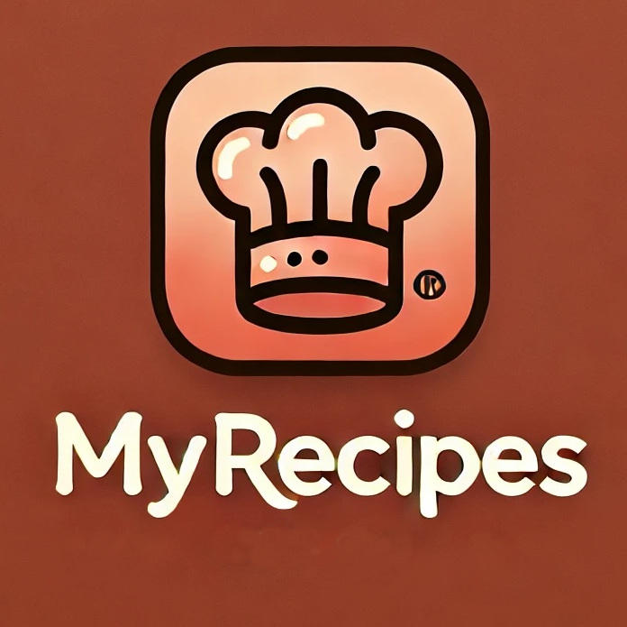

# MyRecipes

<p align="center">
  
</p>

Application Android native **MyRecipes** : consultation de recettes via l’API [TheMealDB](https://www.themealdb.com/api.php) (catégories, cuisines, détail, recherche, favoris locaux, nutri-score custom, mode cuisine).

Objectif : livrable de qualité **Play Store** (Kotlin, `minSdk 26`, layouts XML Material 3).

## Documentation

| Document | Contenu |
|----------|---------|
| [docs/CAHIER_DES_CHARGES.md](docs/CAHIER_DES_CHARGES.md) | Besoins B1–B12 et BN1–BN4 |
| [docs/API.md](docs/API.md) | Endpoints TheMealDB utilisés |
| [docs/maquette/index.html](docs/maquette/index.html) | Maquette visuelle interactive |
| [docs/maquette.md](docs/maquette.md) | Identité visuelle |

## Stack

| Couche | Technologie |
|--------|-------------|
| Langage | Kotlin |
| UI | Android Views (XML) + Material 3, cards image-forward |
| Navigation | Drawer (Categories / Cuisines / Search / Favorites + Surprise) |
| Architecture | Fragments + `FavoritesViewModel` (Room) |
| Réseau | Retrofit / OkHttp (cache HTTP + logging DEBUG) |
| Images | Glide (meals + ingredients) |
| Persistance | Jetpack Room (favoris) |
| API | TheMealDB V1 (clé de test `1`) |

## Features

- CDC B1–B12 (catégories, recettes, détail, nutri-score custom, favoris Room, search, drawer)
- Mode cuisine (préparation + étapes)
- Surprise (`random.php`)
- Cuisines / zones (`list.php?a=list` + `filter.php?a=`)
- YouTube + partage depuis le détail
- Images d’ingrédients
- Bandeau hors-ligne (NetworkMonitor)
- UI Material 3 polish (jour / nuit, landscape)

## Prérequis

- Android Studio (version récente)
- JDK 17+
- Émulateur ou appareil `minSdk 26`

## Lancer le projet

1. Ouvrir le dossier du repo dans Android Studio.
2. Laisser Gradle synchroniser.
3. Lancer la configuration `app` sur un émulateur / appareil.

```text
./gradlew :app:assembleDebug
```

## Build release (Play Store)

```text
./gradlew :app:assembleRelease
./gradlew :app:bundleRelease
```

- APK : `app/build/outputs/apk/release/`
- AAB : `app/build/outputs/bundle/release/`
- R8 / shrinking activés
- `applicationId` : `com.ynov.myrecipes.luque`
- Pour une publication réelle : keystore + clé API TheMealDB supporter

## Licence / attribution

Données recettes : [TheMealDB](https://www.themealdb.com/).  
Projet pédagogique Ynov — Android Natif.
